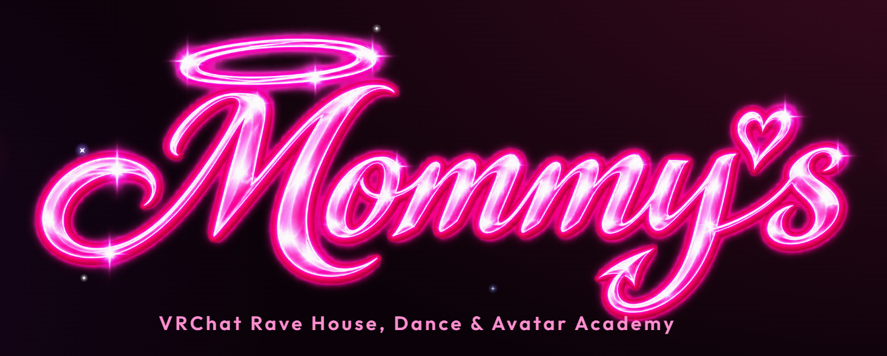

# Mommy's Website

*By Astra.* Mommy's Portfolio: the website of the VRChat Rave House, Dance & Avatar Academy club.

## The Website

**[⬇ Download the website (ZIP)](https://github.com/findastra/mommys-website/archive/refs/heads/main.zip)**, then open
[the saved portfolio draft](mommys-portfolio-20261024.html) in a browser. Keep its accompanying logo PNG beside it. It
is not hosted yet.

**Needs:** a browser. No build step is required.

## Developer Notes

1. **This is a source save, not a hosting deployment.** Astra approved the appearance and requested this GitHub save
   on 2026-10-24.
2. **Separate from Mommy's World:** this club portfolio is separate from Mommy's World's portfolio and Unity project.
   See [PROJECT-BRIEF.md](PROJECT-BRIEF.md) for continuation notes and remaining integrations.

## Credits

1. Designed by Astra. The saved page and its logo: OpenAI Codex (GPT-6), 2026-10-24; earlier work with Claude Opus 5.5,
   from 2026-10-05.
2. The picture above is a screenshot of the saved page, 2026-10-29.

## License

No general source license is granted yet. The design and the logo stay Astra's.
